<div align="center">

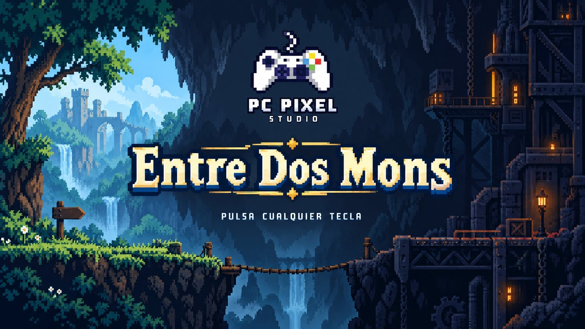

# Entre Dos Mons

**Una aventura de puzles y plataformas 2D en pixel art donde dos personajes, dos mundos y una sola tecla lo cambian todo.**

[](https://unity.com)
[](https://learn.microsoft.com/dotnet/csharp/)
[](https://docs.unity3d.com/Packages/com.unity.render-pipelines.universal@17.3/manual/index.html)
[](https://pabloabaad25.itch.io/entre-dos-mundos)
[](https://www.instagram.com/pcpixelstudio_oficial/)


[Jugar en itch.io](https://pabloabaad25.itch.io/entre-dos-mundos) ·
[Instagram](https://www.instagram.com/pcpixelstudio_oficial/) ·
[Ramas](#-ramas-del-repositorio) ·
[Cómo abrir el proyecto](#-cómo-abrir-el-proyecto)

</div>

---

## 🌄 Sobre el juego

Una vieja estación de investigación escondida bajo la montaña ha dejado de funcionar y, desde entonces, el pueblo del valle se ha quedado sin luz.

**Nil**, un joven explorador, sube a la montaña con el cuaderno de su padre para descubrir qué ha pasado. Al mismo tiempo, en las cuevas, **Volt**, un pequeño robot de mantenimiento, despierta en la oscuridad con la batería casi vacía.

Los dos avanzan por separado, pero lo que hace uno abre el camino al otro: si Nil tira un tronco al río, el agua deja de entrar en la cueva de Volt; si Volt reactiva un generador, fuera se enciende un ascensor para Nil. El objetivo es llegar al núcleo de la estación y volver a ponerla en marcha en un puzle final donde, por fin, los dos se encuentran.

<div align="center">
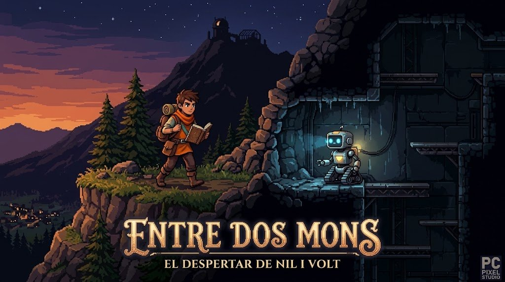
</div>

### ✨ Lo que lo hace especial

| | |
|---|---|
| 🔀 **Dos personajes, dos mundos** | Cambias entre Nil y Volt al instante con una sola tecla. Cada uno se mueve a su manera. |
| 🌍 **Un mundo afecta al otro** | Lo que pasa fuera cambia las cuevas y al revés. Los puzles se piensan con los dos a la vez. |
| 🧲 **Gravedad invertida** | Las botas magnéticas de Volt le dejan caminar por el techo. |
| 🔦 **La luz es un recurso** | En las cuevas no se ve nada sin la linterna de Volt, y la linterna gasta batería. |
| 🪢 **Física divertida** | Cuerdas, péndulos y plataformas para Nil en el bosque. |
| 🕊️ **Difícil pero justo, sin violencia** | El reto es el entorno, no los enemigos. |

Inspirado en *Celeste*, *Brothers: A Tale of Two Sons*, *Limbo* y *Hollow Knight*.

---

## 🧑‍🤝‍🧑 Personajes

<table>
<tr>
<td align="center" width="50%">
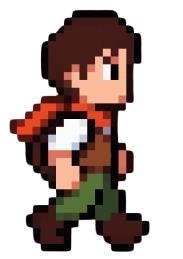<br>
<b>Nil</b><br>
Explorador de montaña. Recorre el bosque con cuerdas y péndulos siguiendo el cuaderno de su padre.
</td>
<td align="center" width="50%">
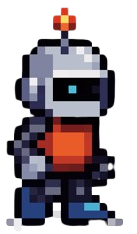<br>
<b>Volt</b> (VLT-05)<br>
Robot de mantenimiento de la estación. Botas magnéticas, linterna y una batería que se agota.
</td>
</tr>
</table>

---

## 🎮 Controles

| Acción | Teclado |
|---|---|
| Moverse | `A` / `D` o flechas |
| Saltar | `Espacio` o `W` |
| Cambiar entre Nil y Volt | `Q` |
| Invertir la gravedad (solo Volt) | `F` |
| Interactuar / avanzar diálogo | `E` |

---

## 🗺️ Niveles generados por código

Los niveles **no se pintan a mano** con la Tile Palette: se escriben como texto en C# y el juego los construye al arrancar. Cada carácter es una casilla de 32×32 px.

```csharp
// Assets/Scripts/Levels/LevelLibrary.cs (fragmento del Prólogo)
"....L...............................T.....................E.",
"....................---.............|...........======....C.",
".N.1.2.3..f..a...6...XX....a..f.....|......=====######.a....",
"=====================BB=====~~~~============##########======",
```

| Carácter | Significado |
|---|---|
| `N` / `V` | Aparición de Nil / Volt |
| `C` / `E` | Checkpoint / salida del nivel |
| `1`–`9` | Disparador de diálogo |
| `=` `-` `r` | Hierba, plataforma de madera, roca (con bordes automáticos) |
| `#` `B` `X` `R` `M` | Tierra, bloque de piedra, caja, roca de cueva, plataforma metálica |
| `~` `w` `\|` `T` `L` … | Agua, cuerda, farol, cristales, tuberías, engranajes… (decoración) |

La leyenda completa está en `LevelLegend.cs`. `LevelBuilder` coloca los tiles en las capas *Fondo*, *Suelo* (con colisión) y *Decoración*, pone los personajes, checkpoints, salida, diálogos, paredes y límites de cámara.

<div align="center">
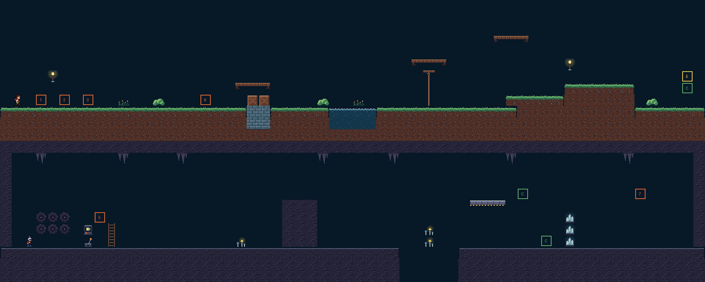<br>
<sub><b>Nivel 0 · Prólogo</b>: el bosque de Nil arriba y las cuevas de Volt abajo.</sub>
<br><br>
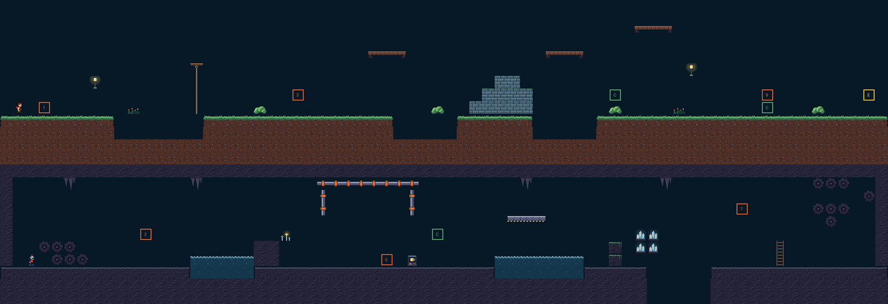<br>
<sub><b>Nivel 1 · Capítulo 1</b></sub>
</div>

---

## 🎨 Arte

Pixel art a 32 px por unidad, con cámara *Pixel Perfect* a 640×360. Dos juegos de 16 tiles: el exterior (`ext_*`, bosque) y las cuevas (`cova_*`).

<div align="center">
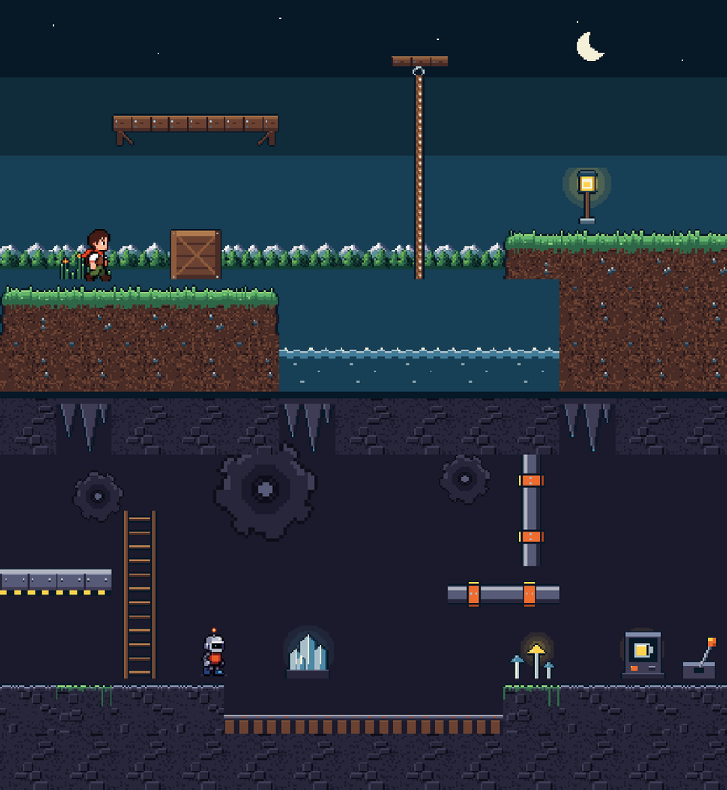
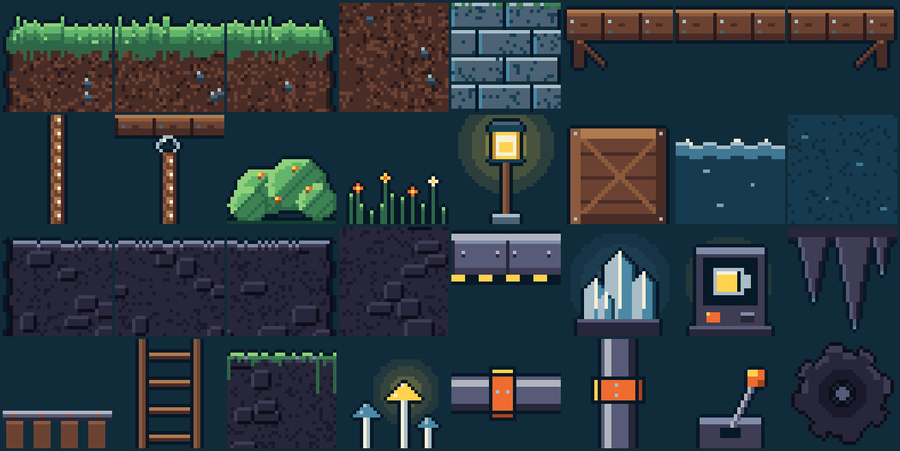
</div>

---

## 🌿 Ramas del repositorio

| Rama | Contenido |
|---|---|
| [`main`](../../tree/main) | Paquete de arranque: la carpeta `Assets/` con tiles, sprites, scripts del jugador, sistema de diálogos y el menú de editor **Entre Dos Mons**. Pensado para copiarlo dentro de un proyecto de Unity. |
| [`upload/entre-dos-mons`](../../tree/upload/entre-dos-mons) | **Avance actual del juego.** El proyecto de Unity completo (`Assets/`, `Packages/`, `ProjectSettings/`, `.gitignore`) con Unity 6.3 LTS y URP 2D. Añade los niveles por código (`Scripts/Levels/`), las paletas *Exterior* y *Coves*, la escena `SampleScene` y la configuración de render e input. |

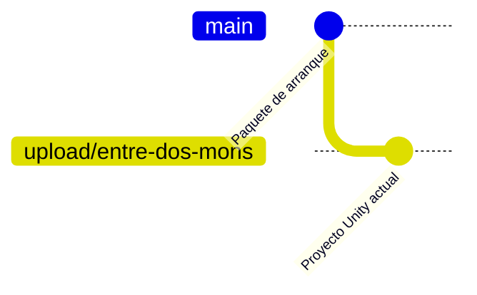

> Para probar el juego tal y como está ahora, usa la rama `upload/entre-dos-mons`.

---

## 🚀 Cómo abrir el proyecto

**Requisitos:** Unity **6.3 LTS (6000.3.23f1)** con Unity Hub, y Visual Studio o Rider para el código.

```bash
git clone -b upload/entre-dos-mons https://github.com/CyrailJR11/Projecte-Intermodular-de-Desenvolupament-d-Aplicacions-Multiplataforma.git
```

1. En Unity Hub, pulsa **Add project from disk** y elige la carpeta clonada.
2. Abre `Assets/Scenes/SampleScene.unity`.
3. Usa el menú **Entre Dos Mons** de la barra superior:
   - **1. Crear tiles y paletas**: crea un Tile por cada PNG y las paletas *Exterior* y *Coves*.
   - **2. Preparar escena de prueba**: Grid con 3 Tilemaps, cámara pixel perfect, Nil, Volt y el gestor de diálogos.
   - **3. Usar niveles por código**: monta el nivel a partir de `LevelLibrary`.
4. Pulsa ▶️ **Play**.

---

## 📁 Estructura

```text
Assets/
├── Art/
│   ├── Characters/   Nil (4 fotogramas) y Volt (6), 32×32
│   ├── Palettes/     Exterior y Coves
│   └── Tiles/        32 tiles 32×32 (ext_* y cova_*)
├── Editor/           Menú "Entre Dos Mons" e importador de pixel art
├── Resources/
│   └── Dialogues/    dialogos_es.json (guion de Nil y Volt)
├── Scenes/           SampleScene
└── Scripts/
    ├── Dialogue/     DialogueManager, DialogueUI, DialogueTrigger…
    ├── Levels/       LevelLibrary, LevelLegend, LevelBuilder, LevelExit
    └── Player/       PlayerController2D, CharacterSwitcher, CameraFollow2D…
```

---

## 🛠️ Tecnologías

- **Unity 6.3 LTS** con **URP 2D**, Tilemap y Input System
- **C#** (namespace `EntreDosMons`)
- **Krita** y **Piskel** para el pixel art
- **Visual Studio / VS Code** para programar
- **GitHub** para el control de versiones y **Trello** para la planificación

---

## 👥 PC Pixel Studio

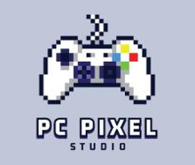

Somos **Pablo Abad Ortega** y **Carlos Rodríguez**, un pequeño estudio indie de Girona. *Entre Dos Mons* es nuestro Projecte Intermodular del **CFGS de Desarrollo de Aplicaciones Multiplataforma (DAM)**, curso 2026-2027.

| | Rol |
|---|---|
| **Pablo Abad Ortega** | Diseño, arte e interfaz |
| **Carlos Rodríguez** ([@CyrailJR11](https://github.com/CyrailJR11)) | Programación, producción y sonido |

📸 Síguenos en Instagram: [@pcpixelstudio_oficial](https://www.instagram.com/pcpixelstudio_oficial/)
🕹️ Página del juego: [pabloabaad25.itch.io/entre-dos-mundos](https://pabloabaad25.itch.io/entre-dos-mundos)

<div align="center">
<br>
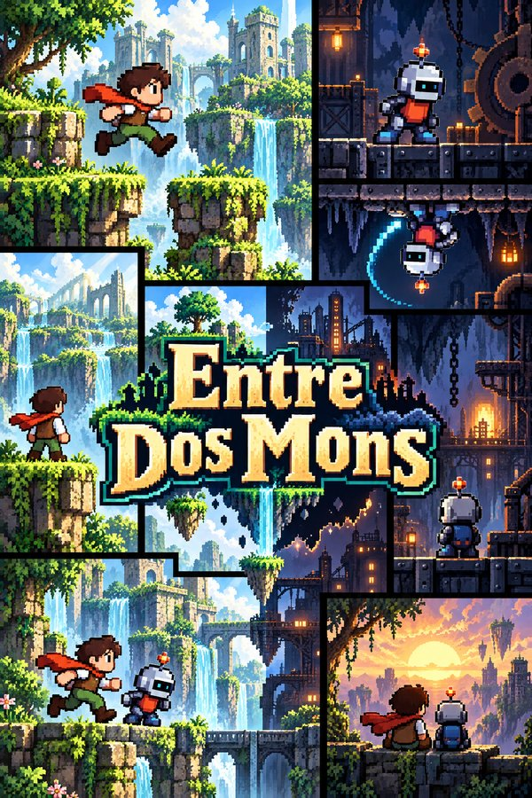
<br><br>
<sub>© 2026 PC Pixel Studio · Girona. Proyecto académico.</sub>
</div>
