<div align="center">

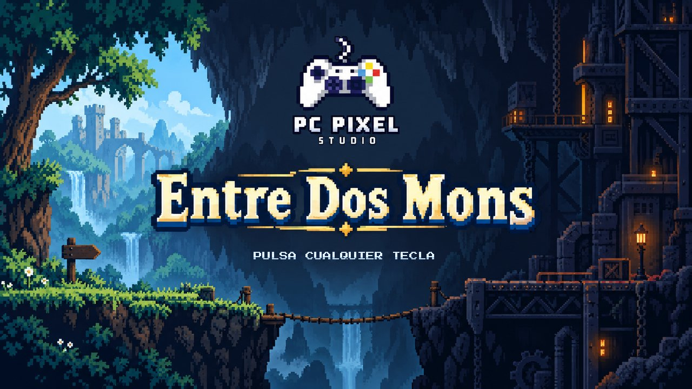

# Entre Dos Mundos

**Una aventura de puzles y plataformas 2D en pixel art donde dos personajes, dos mundos y una sola tecla lo cambian todo.**

[](https://unity.com)
[](https://learn.microsoft.com/dotnet/csharp/)
[](https://docs.unity3d.com/Packages/com.unity.render-pipelines.universal@17.3/manual/index.html)
[](https://pabloabaad25.itch.io/entre-dos-mundos)
[](https://www.instagram.com/pcpixelstudio_oficial/)


[Jugar en itch.io](https://pabloabaad25.itch.io/entre-dos-mundos) ·
[Instagram](https://www.instagram.com/pcpixelstudio_oficial/) ·
[Cómo cooperan](#-cómo-cooperan-nil-y-volt) ·
[Arquitectura](#-arquitectura-poo) ·
[Ramas](#-ramas-del-repositorio) ·
[Cómo abrir el proyecto](#-cómo-abrir-el-proyecto)

</div>

---

## 🌄 Sobre el juego

Una vieja estación de investigación escondida bajo la montaña ha dejado de funcionar y, desde entonces, el pueblo del valle se ha quedado sin luz.

**Nil**, un joven explorador, sube a la montaña con el cuaderno de su padre para descubrir qué ha pasado. Al mismo tiempo, en las cuevas, **Volt**, un pequeño robot de mantenimiento, despierta en la oscuridad con la batería casi vacía.

Los dos avanzan por separado, pero lo que hace uno abre el camino al otro: si Nil tira un tronco al río, el agua deja de entrar en la cueva de Volt; si Volt reactiva un generador, fuera se enciende un ascensor para Nil. El objetivo es llegar al núcleo de la estación y volver a ponerla en marcha en un puzle final donde, por fin, los dos se encuentran.

<div align="center">
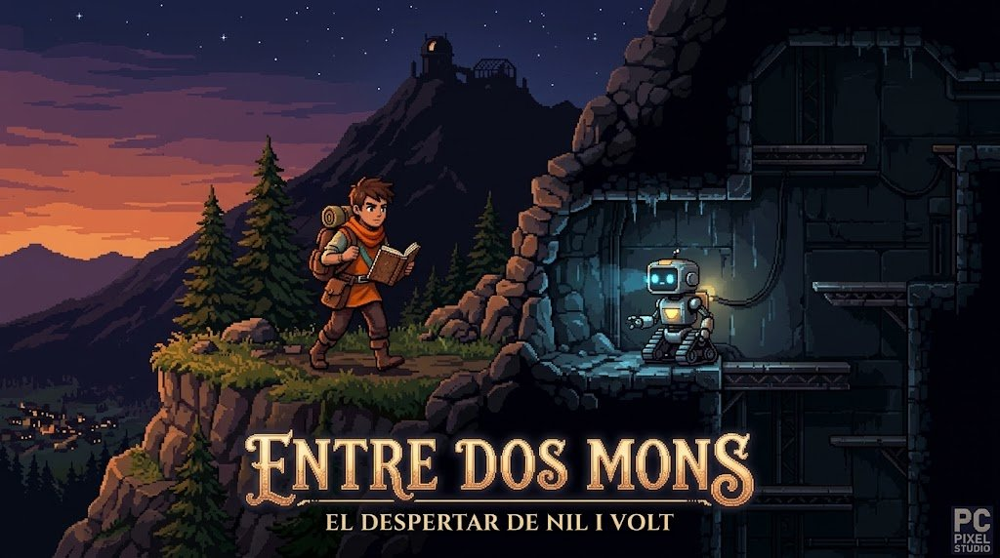
</div>

### ✨ Lo que lo hace especial

| | |
|---|---|
| 🔀 **Dos personajes, dos mundos** | Cambias entre Nil y Volt al instante con una sola tecla. Cada uno se mueve a su manera. |
| 🌍 **Un mundo afecta al otro** | Lo que pasa fuera cambia las cuevas y al revés. Los puzles se piensan con los dos a la vez. |
| 🧲 **Gravedad invertida** | Las botas magnéticas de Volt le dejan caminar por el techo. |
| 🔦 **La luz es un recurso** | En las cuevas no se ve nada sin la linterna de Volt, y la linterna gasta batería. |
| 🪢 **Física divertida** | Cuerdas, péndulos y plataformas para Nil en el bosque. |
| 🕊️ **Difícil pero justo, sin violencia** | El reto es el entorno, no los enemigos. |
| 🤝 **Ninguno termina solo** | Cada nivel solo se supera si los dos se ayudan. Un solucionador automático lo comprueba. |

Inspirado en *Celeste*, *Brothers: A Tale of Two Sons*, *Limbo* y *Hollow Knight*.

---

## 🧑‍🤝‍🧑 Personajes

<table>
<tr>
<td align="center" width="50%">
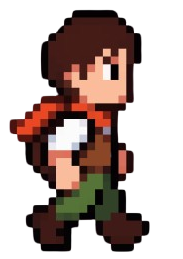<br>
<b>Nil</b><br>
Explorador de montaña. Recorre el bosque con cuerdas y péndulos siguiendo el cuaderno de su padre.
</td>
<td align="center" width="50%">
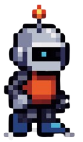<br>
<b>Volt</b> (VLT-05)<br>
Robot de mantenimiento de la estación. Botas magnéticas, linterna y una batería que se agota.
</td>
</tr>
</table>

---

## 🎮 Controles

| Acción | Teclado |
|---|---|
| Moverse | `A` / `D` o flechas |
| Saltar | `Espacio` o `W` |
| Trepar cuerdas y escaleras | `W` / `S` |
| Cambiar entre Nil y Volt | `Q` |
| Girar válvula (Nil) / usar terminal (Volt) / avanzar diálogo | `E` |
| Invertir la gravedad (solo Volt) | `F` |
| Encender la linterna (solo Volt) | `L` |
| Reiniciar el nivel | `R` |

---

## 🤝 Cómo cooperan Nil y Volt

La dependencia sale de lo que sabe hacer cada uno:

| | Nil (bosque) | Volt (cuevas) |
|---|---|---|
| Empujar cajas | ✅ tiene fuerza | ❌ no las mueve |
| Girar válvulas | ✅ | ❌ |
| Usar terminales eléctricos | ❌ | ✅ con su batería |
| Invertir la gravedad | ❌ | ✅ |
| Linterna | ❌ | ✅ gasta batería |
| Agua | ✅ bucea con aire limitado | ❌ le descarga la batería |

Lo que acciona uno abre el camino del otro. Los objetos se conectan con una **capa de cables**: una letra encima de una fuente (válvula, terminal, placa, cristal) y la misma letra encima de un receptor (compuerta, montacargas, agua que se vacía). Una lucecita del color del canal indica qué está conectado con qué. El nivel termina cuando **los dos** llegan a su salida.

**Prólogo:** Nil pisa la placa que abre la compuerta de Volt; Volt activa el terminal que sube el montacargas de Nil.

**Capítulo 1:** Volt apaga la valla eléctrica del bosque; Nil vacía la galería inundada de Volt; Nil deja una caja sobre una trampilla, Volt la abre y la caja cae sobre una placa de la cueva que abre la puerta de Volt; Volt enciende el generador que sube a Nil.

---

## 🗺️ Niveles generados por código

Los niveles **no se pintan a mano** con la Tile Palette: se escriben como texto en C# y el juego los construye al arrancar. Cada carácter es una casilla de 32×32 px.

```csharp
// Assets/Scripts/Levels/LevelLibrary.cs (fragmento del Prólogo)
".................f..............::==========================",
"................BBBB............::##########################",
".N.1.2.3.L.X....BBBB.a6.o...af..HH##########################",
"============================================================",
```

Cada nivel tiene además una **capa de cables** con las mismas medidas, donde una letra (`a`–`z`) conecta fuentes y receptores.

| Carácter | Significado |
|---|---|
| `N` / `V` | Aparición de Nil / Volt |
| `C` / `E` | Checkpoint / salida del nivel |
| `1`–`9` | Disparador de diálogo |
| `=` `-` `r` | Hierba, plataforma de madera, roca (con bordes automáticos) |
| `#` `B` `X` `R` `M` | Tierra, bloque de piedra, caja, roca de cueva, plataforma metálica |
| `X` | Caja: solo Nil la empuja |
| `p` / `G` / `o` / `k` | Válvula (Nil), terminal (Volt), placa de presión, cristal (fuentes de señal) |
| `D` / `H` `:` | Compuerta o trampilla / montacargas y su recorrido (receptores) |
| `c` | Cargador de batería de Volt (y su checkpoint) |
| `^` `P` `e` | Pinchos, cuerda-péndulo, escalera |
| `~` `w` `\|` `T` `L` … | Agua, cuerda, farol, cristales, tuberías, engranajes… (decoración) |

La leyenda completa está en `LevelLegend.cs`. `LevelBuilder` coloca los tiles en las capas *Fondo*, *Suelo* (con colisión) y *Decoración*, pone los personajes, checkpoints, salida, diálogos, paredes y límites de cámara.

<div align="center">
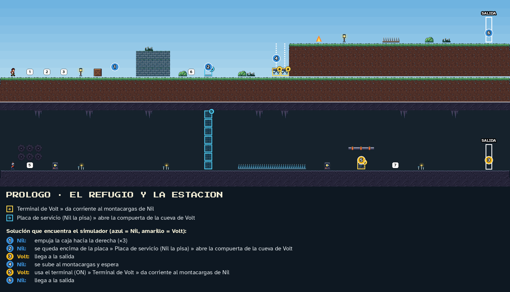<br>
<sub><b>Nivel 0 · Prólogo</b>: el bosque de Nil arriba y las cuevas de Volt abajo, con la solución numerada.</sub>
<br><br>
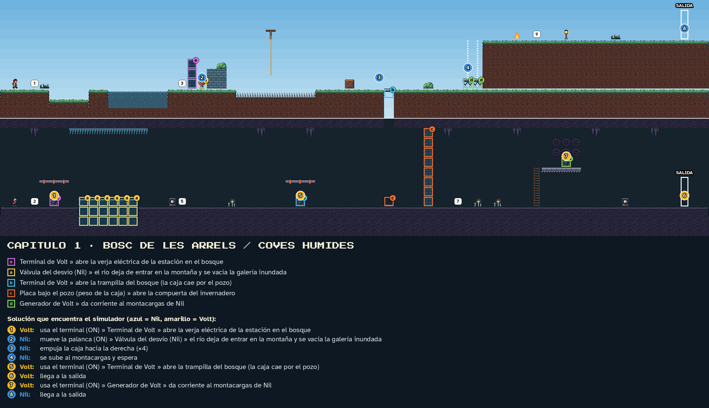<br>
<sub><b>Nivel 1 · Capítulo 1</b></sub>
</div>

---

## 🧱 Arquitectura POO

Cada concepto está marcado en el código con un comentario `[POO · …]`.

```text
PlayerCharacter (abstracta)          CharacterResource (abstracta)
 ├─ NilCharacter                      ├─ NilBreath    (aire)
 └─ VoltCharacter                     └─ VoltBattery  (batería)

SignalSource (abstracta)             SignalReceiver (abstracta)
 ├─ InteractableSource (abstracta)    ├─ Door  (compuerta o trampilla)
 │   ├─ Lever     (solo Nil)          ├─ Lift  (montacargas)
 │   └─ Terminal  (solo Volt)         └─ DrainableWater
 ├─ PressurePlate
 └─ Crystal
```

- **Herencia:** lo común (moverse, saltar, cuerdas, agua) está en `PlayerCharacter`; Nil y Volt solo añaden lo suyo.
- **Abstracción:** las clases base son `abstract` y cada personaje declara sus habilidades con el enum `[Flags] CharacterAbility`.
- **Polimorfismo:** el HUD pinta cualquier `CharacterResource`; interfaces `IInteractable`, `ISignalReceiver`, `IPushable`, `IDamageable`, `ILightReceiver` e `IInputSource`.
- **Encapsulamiento:** campos privados con propiedades de solo lectura; un `LevelDefinition` no se puede modificar después de crearlo.
- **Prefabs:** `Assets/Resources/Prefabs`, creados por código (`PrefabFactory`) e instanciados por el `LevelBuilder`.

### ✅ Pruebas

- `LevelSolver` recorre todos los estados de cada nivel y comprueba que tiene solución, que **ningún objeto sobra** y que **Nil y Volt se necesitan**.
- Tests **EditMode** (flujo de niveles, prefabs, red de señales) y **PlayMode** (empujar cajas, placas, válvulas, montacargas) en *Window › General › Test Runner*.

---

## 🎨 Arte

Pixel art a 32 px por unidad, con cámara *Pixel Perfect* a 640×360. Dos juegos de 16 tiles: el exterior (`ext_*`, bosque) y las cuevas (`cova_*`).

**Tipografía oficial:** [Press Start 2P](https://fonts.google.com/specimen/Press+Start+2P) para títulos, nombres y números, y [Atkinson Hyperlegible](https://fonts.google.com/specimen/Atkinson+Hyperlegible) para diálogos y textos largos (HUD, diálogos, imágenes y presentación).

<div align="center">
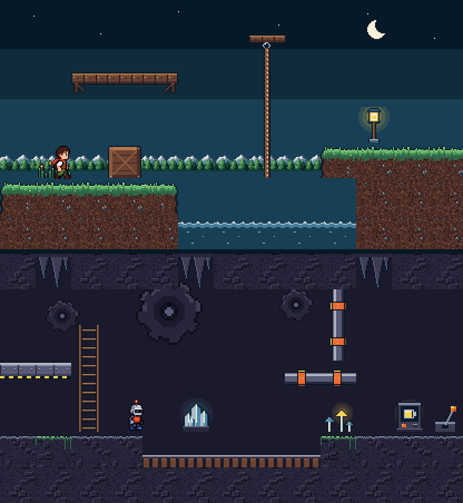
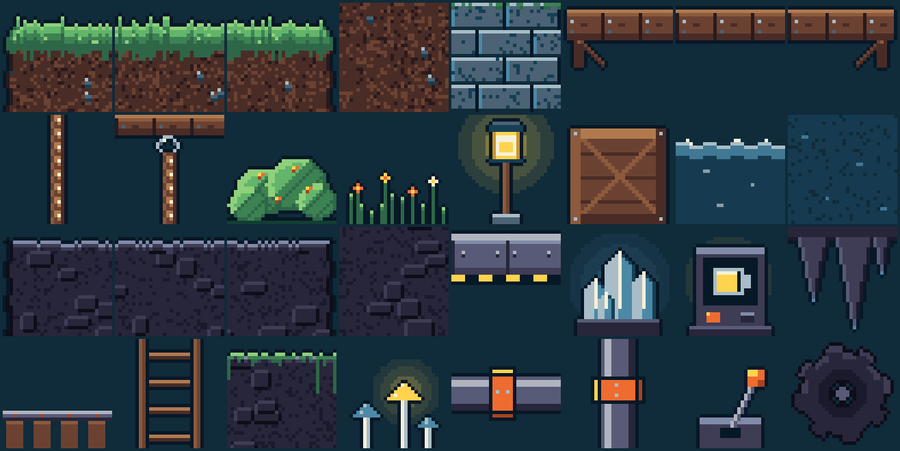
</div>

---

## 🌿 Ramas del repositorio

| Rama | Contenido |
|---|---|
| [`main`](../../tree/main) | **Versión actual del juego.** Proyecto de Unity 6.3 LTS completo: arquitectura POO, prefabs, puzles cooperativos, pruebas y pantalla 2560×1440. Usa esta. |
| [`upload/entre-dos-mons`](../../tree/upload/entre-dos-mons) | Primera subida del proyecto completo (niveles por código, paletas, escena). Ya fusionada en `main`. |
| `claude/*` | Ramas de trabajo de cada cambio (mecánicas, diálogos, refactor POO, pantalla…). Todas fusionadas en `main` mediante pull requests. |

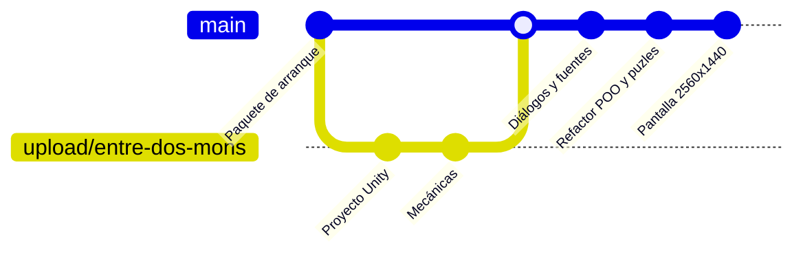

> Para probar el juego tal y como está ahora, usa la rama `main`.

---

## 🚀 Cómo abrir el proyecto

**Requisitos:** Unity **6.3 LTS (6000.3.23f1)** con Unity Hub, y Visual Studio o Rider para el código.

```bash
git clone https://github.com/CyrailJR11/Projecte-Intermodular-de-Desenvolupament-d-Aplicacions-Multiplataforma.git
```

1. En Unity Hub, pulsa **Add project from disk** y elige la carpeta clonada.
2. Abre `Assets/Scenes/SampleScene.unity`.
3. Usa el menú **Entre Dos Mundos** de la barra superior:
   - **1. Crear tiles y paletas**: crea un Tile por cada PNG y las paletas *Exterior* y *Coves*.
   - **2. Preparar escena de prueba**: Grid con 3 Tilemaps, cámara pixel perfect y el gestor de diálogos.
   - **3. Usar niveles por código**: monta el nivel a partir de `LevelLibrary`.
   - **4. Crear prefabs**: rehace los prefabs (se crean solos al abrir el proyecto).
   - **5. Validar niveles**: escribe en la Consola la solución de cada nivel.
4. Pulsa ▶️ **Play**.

### 🖥️ Pantalla (2560×1440 y otras)

El juego se dibuja a **640×360** y se amplía con la Pixel Perfect Camera (`Core/ScreenSetup.cs`):

| Pantalla | Ampliación | Resultado |
|---|---|---|
| 2560×1440 | ×4 exacto | Nítido y sin bordes |
| 1920×1080 | ×3 exacto | Nítido y sin bordes |
| 3840×2160 | ×6 exacto | Nítido y sin bordes |
| Otras | múltiplo entero + estirado mínimo | Sin bandas negras |

- En la versión compilada arranca a pantalla completa con la resolución del monitor.
- En el Editor, en la pestaña **Game**, elige **2560x1440** en el desplegable de resolución (o añádela con **+**) y deja la escala en **1x**. Desmarca *Low Resolution Aspect Ratios*.

---

## 📁 Estructura

```text
Assets/
├── Art/
│   ├── Characters/   Nil (4 fotogramas) y Volt (6), 32×32
│   ├── Palettes/     Exterior y Coves
│   └── Tiles/        32 tiles 32×32 (ext_* y cova_*)
├── Editor/           Menú "Entre Dos Mundos" e importador de pixel art
├── Resources/
│   ├── Dialogues/    dialogos_es.json (guion de Nil y Volt)
│   └── Prefabs/      Nil, Volt, Caja, Valvula, Terminal, PlacaPresion… (los crea el menú 4)
├── Scenes/           SampleScene (sin personajes fijos: el LevelBuilder los instancia)
├── Tests/            EditMode (flujo de niveles) y PlayMode (físicas de cajas, placas, montacargas)
└── Scripts/          ensamblado EntreDosMons.asmdef
    ├── Core/         interfaces (IInteractable, ISignalReceiver, IPushable…), WorldMap, entrada
    ├── Characters/   PlayerCharacter (abstracta) → NilCharacter / VoltCharacter, vidas, aire, batería
    ├── Mechanics/    Signals/ (válvula, terminal, placa, cristal → compuerta, montacargas, desagüe), cajas…
    ├── Levels/       LevelLibrary, LevelBuilder, Prefabs/ y Validation/ (solucionador automático)
    ├── Dialogue/     DialogueManager, DialogueUI, DialogueTrigger…
    └── Player/       CharacterSwitcher, CameraFollow2D, GameInput…
```

Vistas previas de los niveles con su solución: [`Docs/niveles/`](Docs/niveles).

---

## 🛠️ Tecnologías

- **Unity 6.3 LTS** con **URP 2D**, Tilemap y Input System
- **C#** (namespace `EntreDosMons`)
- **Krita** y **Piskel** para el pixel art
- **Visual Studio / VS Code** para programar
- **GitHub** para el control de versiones y **Trello** para la planificación

---

## 👥 PC Pixel Studio

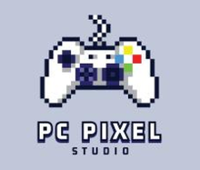

Somos **Pablo Abad Ortega** y **Carlos Rodríguez**, un pequeño estudio indie de Girona. *Entre Dos Mundos* es nuestro Projecte Intermodular del **CFGS de Desarrollo de Aplicaciones Multiplataforma (DAM)**, curso 2026-2027.

| | Rol |
|---|---|
| **Pablo Abad Ortega** ([@pabloabaad25](https://github.com/pabloabaad25)) | Diseño, arte e interfaz |
| **Carlos Rodríguez** ([@CyrailJR11](https://github.com/CyrailJR11)) | Programación, producción y sonido |

📸 Síguenos en Instagram: [@pcpixelstudio_oficial](https://www.instagram.com/pcpixelstudio_oficial/)<br>
🕹️ Página del juego: [pabloabaad25.itch.io/entre-dos-mundos](https://pabloabaad25.itch.io/entre-dos-mundos)

<div align="center">
<br>
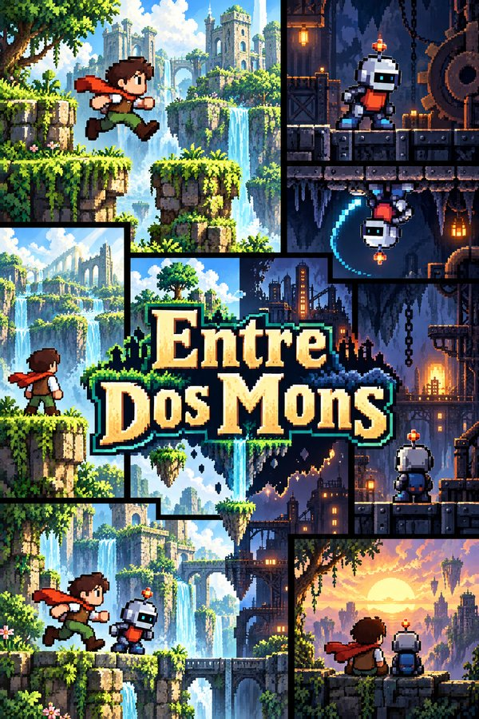
<br><br>
<sub>© 2026 PC Pixel Studio · Girona. Proyecto académico.</sub>
</div>
